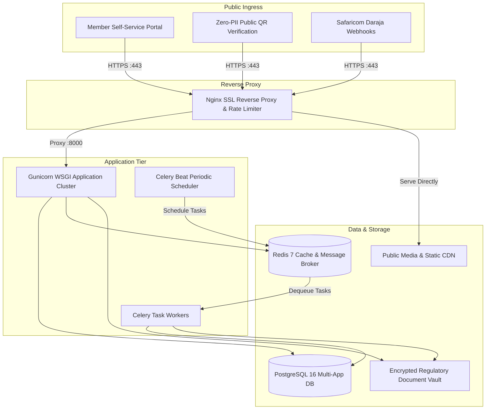

# Northern Highways Transporters SACCO Management System (NHT-SMS)

[](https://github.com/northernhighways/nht-sms)
[](docs/SECURITY.md)
[](https://www.python.org/)
[](https://www.djangoproject.com/)
[](https://www.postgresql.org/)
[]()

Northern Highways Transporters SACCO Management System (**NHT-SMS**) is an enterprise-grade SACCO ERP and Fleet Regulatory Compliance platform specifically engineered for public service transport cooperatives in Kenya. It provides unified, database-backed management of membership, multi-ownership commercial fleets, tamper-proof regulatory document vaults, automated KeNHA/NTSA/Insurance expiry tracking, Safaricom Daraja M-Pesa automated billing & payment reconciliation, a double-entry general ledger with immutability guarantees, and a member self-service portal.

---

## 1. System Architecture Overview

NHT-SMS is built as a hardened **Modular Monolith** using Django 6 and PostgreSQL 16, packaged for zero-downtime containerized or bare-metal Ubuntu VPS deployment.



---

## 2. Core Functional Capabilities

| Module | Features & Business Logic |
|---|---|
| **Membership & Fleets** | Multi-tiered membership lifecycle (`PENDING` -> `ACTIVE` -> `SUSPENDED`), co-ownership allocation percentages (strict 100% sum verification), vehicle-to-route scheduling, and driver PSV certifications. |
| **Document Vault & Compliance** | Isolated filesystem storage (`media/private/`), SHA-256 binary checksums, magic-byte inspection (blocking renamed scripts), and automated compliance expiry scanning ([30, 14, 7, 3, 0] days). |
| **Zero-PII Public QR Badges** | Printable vehicle compliance certificates with dynamic QR codes. Public scanning exposes only regulatory compliance status without member national ID, phone, or private documents. |
| **Billing & Payments** | Itemized invoicing with strict separation of SACCO revenue from KeNHA/NTSA pass-through statutory fees. Safaricom Daraja STK Push & C2B callbacks with row-level locking (`select_for_update()`) and idempotency defense. |
| **Maker-Checker Finance** | Segregation of duties for manual bank deposit vouchers and expenditure approvals: staff cannot authorize vouchers they recorded. |
| **Double-Entry General Ledger** | Standard 5-tier Chart of Accounts, real-time balance tracking, balanced journal assertions ($\sum \text{Debit} = \sum \text{Credit}$), period locking, and posted journal immutability (reversal-only corrections). |
| **Multi-Channel Dispatch** | Decoupled notification adapters for Africa's Talking (SMS), Meta WhatsApp Cloud API, SMTP Email, and In-App notification center with member preference controls. |
| **Member Self-Service** | Responsive portal (`/portal/`) with strict anti-IDOR checks, running balance statements, online document renewal submissions, and vehicle card generation. |
| **SACCO Governance** | Maintenance order tracking with downtime analytics, incident grievance investigations, committee meeting agendas, and formal resolution voting records. |
| **Unified REST API & Material UI SPA** | Unified DRF `/api/v1/` across all 18 apps powering a responsive zero-build React 19.3.1 + Material UI 9.6.0 ES Module SPA (`/app/` & `/admin/`) with `htm` and role-scoped navigation across all 11 personas (including `MEMBER` and `DRIVER` portals). |
| **Payment Reconciliation & Statements** | Automated `PaymentReconciliationService` comparing payments, receipts, invoices, and GL journals, plus live Income & Expenditure and Balance Sheet reports. |
| **Executive Analytics** | Executive dashboard with real-time operational metrics, branded compliance PDF report exports (`fpdf2`), and multi-tab financial Excel reconciliation workbooks (`openpyxl`). |

---

## 3. Technology Stack

- **Backend Runtime:** Python 3.15
- **Web Framework:** Django 6.1.3 + Django REST Framework 3.18.3+
- **Frontend Architecture:** Zero-build native ES Modules (`<script type="importmap">` + `esm.sh` + `htm` 3.1.1), React 19.3.1, Material UI 9.6.0, ApexCharts 3.54.1
- **Database Engine:** PostgreSQL 16+ (with `psycopg` 3.3.9+)
- **Cache & Message Broker:** Redis 7+ (`redis` 8.2+)
- **Background Processing:** Celery 5.7+ + Celery Beat (`PersistentScheduler`)
- **WSGI / Web Server:** Gunicorn 27.0+ + Nginx 1.27
- **Security & MFA:** `django-axes` 9.1+ (brute-force defense) + `django-otp` 1.7.5+ (TOTP MFA)
- **Document Generation:** `fpdf2` 2.9+ (PDF generation) + `openpyxl` 3.1.5+ (Excel exports) + `qrcode` 8.2 (QR tokens)
- **Testing Suite:** `pytest` 9.2+ + `pytest-django` 4.14+ (165 automated tests across 16 stages)

---

## 4. Quick Start: Local Development

### 4.1 Prerequisites
- Python 3.15
- PostgreSQL 16+
- Redis (optional for development; required for background queues)

### 4.2 Installation
```bash
# 1. Clone repository
git clone https://github.com/bagoviofficial/NHT-SMS.git
cd nht-sms

# 2. Create virtual environment
python -m venv venv
source venv/bin/activate

# 3. Install development dependencies
pip install -r requirements/development.txt

# 4. Set up environment configuration
cp .env.example .env
# Edit .env with your local PostgreSQL credentials

# 5. Apply migrations
python manage.py migrate

# 6. Seed baseline master data
python manage.py seed_sacco_admin
python manage.py seed_sacco_fleet
python manage.py seed_document_types
python manage.py seed_billing_services
python manage.py seed_chart_of_accounts
python manage.py seed_notification_templates

# 7. Start local development server
python manage.py runserver
```

Navigate to `http://127.0.0.1:8000/app/` for the Material UI SPA or `http://127.0.0.1:8000/` for the classic portal login.

---

## 5. Production Deployment

### 5.1 Docker Compose (Recommended)
```bash
# 1. Configure production environment
cp .env.production.example .env.production
# Securely edit database passwords, secret keys, and domain names in .env.production

# 2. Build and launch multi-container stack
docker compose up -d --build

# 3. Verify container health
docker compose ps
docker compose logs -f web
```

### 5.2 Bare-Metal Ubuntu VPS Deployment
Refer to the comprehensive [Ubuntu VPS Deployment Guide](docs/DEPLOYMENT_GUIDE.md) for full step-by-step instructions covering Nginx, Let's Encrypt SSL/TLS, and Systemd services.

---

## 6. Documentation Directory

A complete suite of 15 technical and operational guides is maintained in the `docs/` directory:

1. [Project Status & Verification Matrix](PROJECT_STATUS.md)
2. [System Architecture Document](docs/SYSTEM_ARCHITECTURE.md)
3. [Database Schema & Data Dictionary](docs/DATABASE_SCHEMA.md)
4. [REST API Documentation](docs/API_DOCUMENTATION.md)
5. [User Roles & Permissions (RBAC)](docs/USER_ROLES_AND_PERMISSIONS.md)
6. [Security & ASVS Level 2 Verification](docs/SECURITY.md)
7. [Privacy & Data Retention (Kenya ODPC)](docs/PRIVACY_AND_DATA_RETENTION.md)
8. [Safaricom Daraja M-Pesa Integration](docs/PAYMENT_INTEGRATION.md)
9. [Multi-Channel Notification Integration](docs/NOTIFICATION_INTEGRATION.md)
10. [Production Deployment Guide](docs/DEPLOYMENT_GUIDE.md)
11. [Backup & Disaster Recovery Runbook](docs/BACKUP_AND_DISASTER_RECOVERY.md)
12. [Quality Assurance & Testing Report](docs/TESTING_REPORT.md)
13. [Operations & Troubleshooting Runbook](docs/TROUBLESHOOTING.md)
14. [Changelog & Release Notes](docs/CHANGELOG.md)

---

## 7. Automated Testing & Verification

Run the entire automated regression suite:
```bash
# Run pytest test suite
pytest

# Verify Django deployment readiness
DJANGO_SETTINGS_MODULE=nht_sacco.config.settings.production python manage.py check --deploy
```

---

## 8. License & Confidentiality
Copyright &copy; 2026 Northern Highways Transporters SACCO Limited. All Rights Reserved.  
Proprietary and confidential commercial software. Unauthorized copying, distribution, or reverse-engineering is strictly prohibited.
