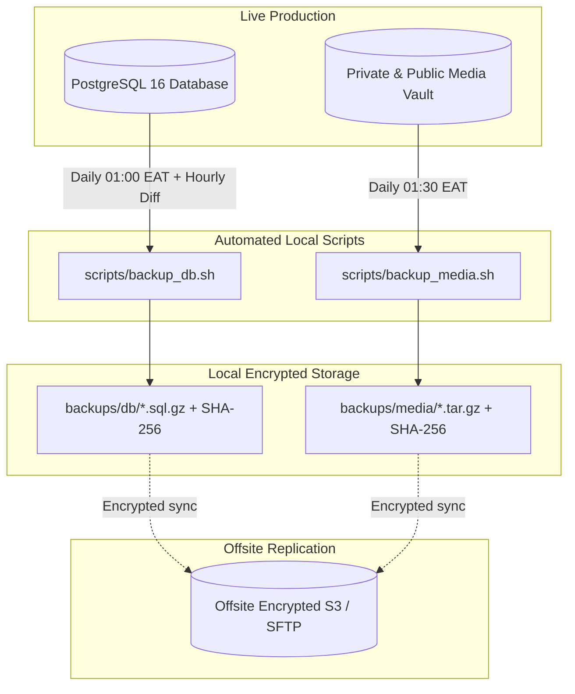

# Backup, Disaster Recovery & Business Continuity — NHT-SMS

**System:** Northern Highways Transporters SACCO Management System (NHT-SMS)  
**Classification:** Mission-Critical Financial & Fleet Compliance Platform  
**Target Recovery Objectives:** RPO &le; 1 Hour | RTO &le; 4 Hours  

---

## 1. Business Continuity Objectives

In the event of hardware failure, catastrophic datacenter outage, ransomware attack, or operator error, the SACCO business continuity plan guarantees:
- **Recovery Point Objective (RPO):** Maximum acceptable data loss window is **1 hour**.
- **Recovery Time Objective (RTO):** Maximum allowable downtime from disaster declaration to full service resumption is **4 hours**.

---

## 2. Backup Architecture & Automated Schedules

The backup framework encompasses two distinct storage repositories:
1. **Relational Database (`PostgreSQL 16`):** All member records, vehicle ownerships, general ledger journals, invoices, and audit logs.
2. **Document & Media Vault (`media/`):** Private regulatory document PDFs/images and public avatar badges.



### 2.1 Automated Cron Schedules
Configure system cron (`sudo crontab -e` on host) to automate daily backups:
```cron
# Daily PostgreSQL Full Backup at 01:00 EAT
0 1 * * * /opt/nht-sms/scripts/backup_db.sh >> /var/log/nht-sms-backup.log 2>&1

# Daily Media Vault Snapshot at 01:30 EAT
30 1 * * * /opt/nht-sms/scripts/backup_media.sh >> /var/log/nht-sms-backup.log 2>&1
```

---

## 3. Cryptographic Checksum Integrity

To defend against silent bit rot or malicious archive tampering:
1. Every backup execution automatically generates a companion `.sha256` checksum file.
2. The restoration utility (`scripts/restore_db.sh`) **mandates** successful SHA-256 verification before executing any restore pipeline:
   ```bash
   sha256sum -c backups/db/nht_sms_db_20261117_222341.sql.gz.sha256
   # Must output: OK
   ```

---

## 4. Offsite Replication Strategy

Local backups must not remain solely on the production host:
- Backups are synced to an offsite secure storage bucket (e.g. AWS S3, Wasabi, or remote SFTP server in an alternate geographic region) using `rclone` or `aws-cli`:
  ```bash
  aws s3 sync /opt/nht-sms/backups/ s3://nht-sacco-backups-encrypted/ --sse aws:kms
  ```

---

## 5. Step-by-Step Disaster Recovery Drill

Scenario: Complete loss of production server host.

### Step 1: Provision Replacement VPS
Provision a fresh Ubuntu 24.04 LTS instance with static IP and firewall rules.

### Step 2: Retrieve Offsite Backups
```bash
# Pull latest database backup and media snapshot from offsite bucket
mkdir -p /opt/nht-sms/backups/db /opt/nht-sms/backups/media
aws s3 cp s3://nht-sacco-backups-encrypted/db/latest.sql.gz /opt/nht-sms/backups/db/
aws s3 cp s3://nht-sacco-backups-encrypted/db/latest.sql.gz.sha256 /opt/nht-sms/backups/db/
aws s3 cp s3://nht-sacco-backups-encrypted/media/latest.tar.gz /opt/nht-sms/backups/media/
aws s3 cp s3://nht-sacco-backups-encrypted/media/latest.tar.gz.sha256 /opt/nht-sms/backups/media/
```

### Step 3: Verify Cryptographic Checksums
```bash
cd /opt/nht-sms/backups/db
sha256sum -c latest.sql.gz.sha256
```

### Step 4: Deploy NHT-SMS Infrastructure
```bash
git clone https://github.com/northernhighways/nht-sms.git /opt/nht-sms
cd /opt/nht-sms
cp .env.production.example .env.production
# Populate .env.production
docker compose up -d db redis
```

### Step 5: Restore PostgreSQL Database
```bash
# Execute automated restoration utility
./scripts/restore_db.sh /opt/nht-sms/backups/db/latest.sql.gz --force
```

### Step 6: Restore Document Media Vault
```bash
tar -xzf /opt/nht-sms/backups/media/latest.tar.gz -C /opt/nht-sms/
```

### Step 7: Launch Application & Verify Health
```bash
docker compose up -d
curl -f http://localhost:8000/health/ready/
# Expect: {"status": "ready", "database": "connected"}
```
