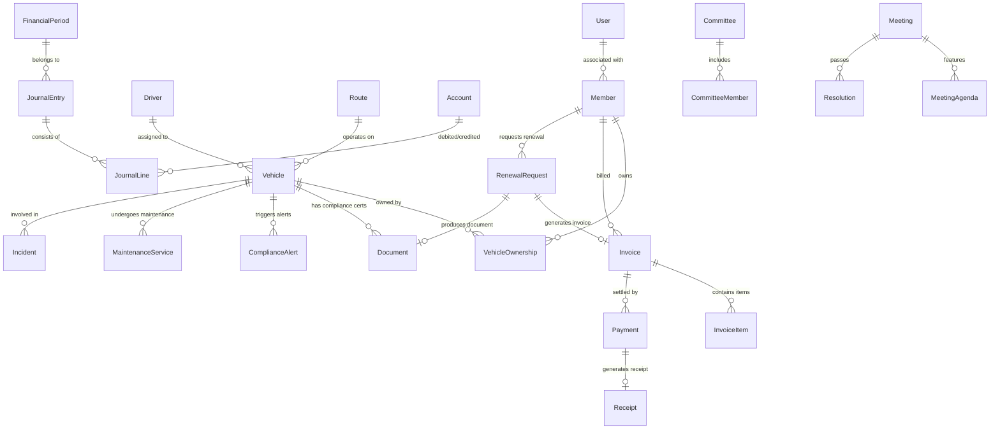

# Database Schema & Data Dictionary — NHT-SMS

**System:** Northern Highways Transporters SACCO Management System (NHT-SMS)  
**Database Engine:** PostgreSQL 16+  
**ORM:** Django 6.1.1  
**Default Primary Key:** UUIDv4 (`django.db.models.UUIDField`)  
**Currency Standard:** Decimal(12, 2) — No Floating Point Arithmetic  

---

## 1. High-Level Entity Relationship Diagram (Core Modules)

---

## 2. Exhaustive Data Dictionary by Domain

### 2.1 Identity, Access & Audit (`accounts`, `audit`)

#### Table: `accounts_user`
| Column | Type | Constraints | Description |
|---|---|---|---|
| `id` | `UUID` | Primary Key, default UUIDv4 | Unique user identity |
| `username` | `VARCHAR(150)` | UNIQUE, NOT NULL, Index | Authentication handle / Staff ID / Membership # |
| `email` | `VARCHAR(254)` | UNIQUE, NOT NULL, Index | Official contact email |
| `phone_number` | `VARCHAR(20)` | UNIQUE, NOT NULL, Index | Primary mobile (E.164 format: `+254...`) |
| `role` | `VARCHAR(30)` | NOT NULL, Index | `SACCO_ADMIN`, `FINANCE_OFFICER`, `COMPLIANCE_OFFICER`, `REGISTRY_CLERK`, `MEMBER`, `DRIVER`, `AUDITOR`, `SYSTEM_ADMIN` |
| `is_active` | `BOOLEAN` | Default True | Access activation toggle |
| `is_staff` | `BOOLEAN` | Default False | Internal admin console flag |
| `is_superuser` | `BOOLEAN` | Default False | Superuser flag |
| `date_joined` | `TIMESTAMPTZ` | Auto now add | Account creation timestamp |

#### Table: `audit_log` *(Cryptographically Immutable)*
| Column | Type | Constraints | Description |
|---|---|---|---|
| `id` | `UUID` | Primary Key, default UUIDv4 | Unique audit event identity |
| `actor` | `UUID` (FK) | NULL, ON DELETE SET_NULL | User executing operation |
| `action` | `VARCHAR(50)` | NOT NULL, Index | Action code (`LOGIN`, `MEMBER_CREATE`, `PAYMENT_ALLOCATE`, etc.) |
| `resource_type`| `VARCHAR(100)` | NOT NULL, Index | Model/resource affected |
| `resource_id` | `VARCHAR(100)` | NOT NULL, Index | Primary key string of target resource |
| `ip_address` | `INET` | NULL | Client remote IP address |
| `user_agent` | `TEXT` | NOT NULL | Browser / client identification |
| `payload` | `JSONB` | Default `{}` | Diff snapshot / context parameters |
| `outcome` | `VARCHAR(20)` | NOT NULL | `SUCCESS`, `FAILED`, `DENIED` |
| `created_at` | `TIMESTAMPTZ` | Auto now add, Index | Immutable timestamp; updates/deletions blocked |

---

### 2.2 Membership & Fleet Management (`members`, `vehicles`, `drivers`, `routes`)

#### Table: `members_member`
| Column | Type | Constraints | Description |
|---|---|---|---|
| `id` | `UUID` | Primary Key, default UUIDv4 | Unique member identifier |
| `user` | `UUID` (FK) | OneToOne, ON DELETE SET_NULL | Portal user account |
| `membership_number`| `VARCHAR(50)` | UNIQUE, NOT NULL, Index | Sequential identifier (`NHT-MBR-XXXX`) |
| `first_name` | `VARCHAR(100)` | NOT NULL | First legal name |
| `last_name` | `VARCHAR(100)` | NOT NULL | Last legal surname |
| `national_id` | `VARCHAR(50)` | UNIQUE, NOT NULL, Index | Republic of Kenya National ID number |
| `phone_number` | `VARCHAR(20)` | UNIQUE, NOT NULL, Index | Verified mobile telephone |
| `status` | `VARCHAR(20)` | NOT NULL | `PENDING`, `ACTIVE`, `SUSPENDED`, `INACTIVE` |
| `joined_date` | `DATE` | NOT NULL | Official admission date |

#### Table: `vehicles_vehicle`
| Column | Type | Constraints | Description |
|---|---|---|---|
| `id` | `UUID` | Primary Key, default UUIDv4 | Unique vehicle identifier |
| `registration_number`| `VARCHAR(20)`| UNIQUE, NOT NULL, Index | Kenya registration plate (`KAA 001A`) |
| `chassis_number` | `VARCHAR(100)`| UNIQUE, NOT NULL | Vehicle VIN / chassis |
| `engine_number` | `VARCHAR(100)`| NOT NULL | Engine serial code |
| `capacity` | `INTEGER` | NOT NULL | Passenger capacity (e.g. 14, 33, 49) |
| `status` | `VARCHAR(20)` | NOT NULL | `ACTIVE`, `GROUNDED`, `SUSPENDED`, `DECOMMISSIONED` |
| `assigned_route` | `UUID` (FK) | NULL, ON DELETE SET_NULL | Route assignment |
| `current_driver` | `UUID` (FK) | NULL, ON DELETE SET_NULL | Assigned certified driver |
| `qr_token` | `UUID` | UNIQUE, NOT NULL, Index | Zero-PII public verification token |

#### Table: `vehicles_ownership`
| Column | Type | Constraints | Description |
|---|---|---|---|
| `id` | `UUID` | Primary Key | Unique ownership allocation |
| `vehicle_id` | `UUID` (FK) | ON DELETE CASCADE | Associated vehicle |
| `member_id` | `UUID` (FK) | ON DELETE CASCADE | Co-owning member |
| `percentage` | `DECIMAL(5, 2)`| NOT NULL | Share percentage (sums to 100.00%) |
| `is_primary` | `BOOLEAN` | Default False | Primary managing owner flag |

---

### 2.3 Regulatory Document Vault & Compliance (`documents`, `compliance`, `renewals`)

#### Table: `documents_document`
| Column | Type | Constraints | Description |
|---|---|---|---|
| `id` | `UUID` | Primary Key | Unique document record |
| `document_type_id` | `UUID` (FK) | ON DELETE PROTECT | Regulatory category |
| `vehicle_id` | `UUID` (FK) | NULL, ON DELETE CASCADE | Linked commercial vehicle |
| `reference_number` | `VARCHAR(100)`| NOT NULL, Index | Policy or certificate serial number |
| `issue_date` | `DATE` | NOT NULL | Start date |
| `expiry_date` | `DATE` | NOT NULL, Index | Expiration date for compliance scanning |
| `file` | `FILE` | NOT NULL | Upload path in `media/private/` (validated by magic-bytes) |
| `file_hash` | `VARCHAR(64)` | NOT NULL | SHA-256 binary integrity checksum |
| `status` | `VARCHAR(20)` | NOT NULL | `PENDING`, `VERIFIED`, `REJECTED`, `EXPIRED`, `SUPERSEDED` |
| `version` | `INTEGER` | Default 1 | Superseded version number |

---

### 2.4 Invoicing, Billing & Payments (`billing`, `payments`)

#### Table: `billing_invoice`
| Column | Type | Constraints | Description |
|---|---|---|---|
| `id` | `UUID` | Primary Key | Unique invoice record |
| `invoice_number` | `VARCHAR(50)` | UNIQUE, NOT NULL, Index | Format: `NHT-INV-YYYY-XXXX` |
| `member_id` | `UUID` (FK) | ON DELETE PROTECT | Debited member |
| `vehicle_id` | `UUID` (FK) | NULL, ON DELETE SET_NULL | Linked vehicle (if fleet related) |
| `subtotal` | `DECIMAL(12, 2)`| NOT NULL, Default 0.00 | SACCO revenue component |
| `statutory_total` | `DECIMAL(12, 2)`| NOT NULL, Default 0.00 | Pass-through KeNHA/NTSA government fees |
| `total_amount` | `DECIMAL(12, 2)`| NOT NULL, Default 0.00 | Grand total (`subtotal + statutory_total`) |
| `amount_paid` | `DECIMAL(12, 2)`| NOT NULL, Default 0.00 | Total settled amount |
| `balance_due` | `DECIMAL(12, 2)`| Computed | `total_amount - amount_paid` |
| `due_date` | `DATE` | NOT NULL, Index | Expiry date for overdue scanning |
| `status` | `VARCHAR(20)` | NOT NULL, Index | `DRAFT`, `ISSUED`, `PARTIALLY_PAID`, `PAID`, `CANCELLED` |

#### Table: `payments_payment`
| Column | Type | Constraints | Description |
|---|---|---|---|
| `id` | `UUID` | Primary Key | Unique payment record |
| `payment_reference`| `VARCHAR(64)` | UNIQUE, NOT NULL, Index | Internal tracking reference (`NHT-PAY-...`) |
| `invoice_id` | `UUID` (FK) | ON DELETE PROTECT | Target invoice |
| `method` | `VARCHAR(20)` | NOT NULL | `MPESA_STK`, `MPESA_C2B`, `BANK_DEPOSIT`, `CHEQUE` |
| `amount` | `DECIMAL(12, 2)`| NOT NULL | Remitted amount |
| `provider_transaction_id` | `VARCHAR(64)` | Index | M-Pesa receipt (`QAA...`) or Bank slip # |
| `status` | `VARCHAR(20)` | NOT NULL | `INITIATED`, `SUCCESS`, `FAILED`, `CANCELLED` |
| `confirmed_at` | `TIMESTAMPTZ` | NULL | Provider timestamp |

---

### 2.5 Double-Entry General Ledger (`accounting`)

#### Table: `accounting_account`
| Column | Type | Constraints | Description |
|---|---|---|---|
| `id` | `UUID` | Primary Key | Unique ledger account |
| `code` | `VARCHAR(20)` | UNIQUE, NOT NULL, Index | Chart of accounts code (e.g. `1010`, `4010`) |
| `name` | `VARCHAR(150)` | NOT NULL | Account name (e.g. Cash, Accounts Receivable) |
| `classification` | `VARCHAR(20)` | NOT NULL | `ASSET`, `LIABILITY`, `EQUITY`, `REVENUE`, `EXPENSE` |
| `current_balance` | `DECIMAL(12, 2)`| Default 0.00 | Running ledger balance |

#### Table: `accounting_journal_entry` *(Immutable when Posted)*
| Column | Type | Constraints | Description |
|---|---|---|---|
| `id` | `UUID` | Primary Key | Unique journal entry |
| `entry_number` | `VARCHAR(50)` | UNIQUE, NOT NULL, Index | Sequential code (`NHT-JRN-YYYY-XXXX`) |
| `posting_date` | `DATE` | NOT NULL, Index | Value date |
| `period_id` | `UUID` (FK) | ON DELETE PROTECT | Financial period (must be unlocked) |
| `is_posted` | `BOOLEAN` | Default False | Posted entries cannot be updated or deleted |
| `is_reversal` | `BOOLEAN` | Default False | Designates balancing correction entries |
| `reversal_of_id` | `UUID` (FK) | NULL, Self-referential | Referenced original journal |

#### Table: `accounting_journal_line`
| Column | Type | Constraints | Description |
|---|---|---|---|
| `id` | `UUID` | Primary Key | Individual line item |
| `entry_id` | `UUID` (FK) | ON DELETE CASCADE | Parent journal entry |
| `account_id` | `UUID` (FK) | ON DELETE PROTECT | Debited or credited account |
| `debit` | `DECIMAL(12, 2)`| NOT NULL, Default 0.00 | Debit entry |
| `credit` | `DECIMAL(12, 2)`| NOT NULL, Default 0.00 | Credit entry |
| *Rule* | *Equilibrium* | $\sum \text{Debit} = \sum \text{Credit}$ | Entry rejected if lines unbalanced |
