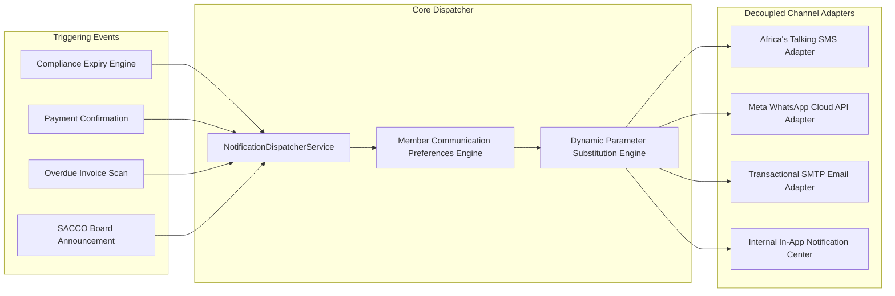

# Multi-Channel Notification Integration Guide — NHT-SMS

**System:** Northern Highways Transporters SACCO Management System (NHT-SMS)  
**Supported Channels:** SMS (Africa's Talking), WhatsApp (Meta Cloud API), Email (SMTP), and In-App  
**Architectural Model:** Decoupled Provider Adapters with Granular Member Opt-Out Preferences  

---

## 1. Multi-Channel Notification Engine Architecture

NHT-SMS provides a unified notification dispatch framework that decouples business domain logic from specific telecommunication and messaging providers:

---

## 2. Supported Provider Adapters

### 2.1 Africa's Talking (SMS Adapter)
- **Module:** `nht_sacco.apps.notifications.adapters.AfricasTalkingSMSAdapter`
- **Use Case:** Immediate compliance expiration alerts, STK payment receipts, and security OTP codes delivered to Kenya mobile numbers (`+254...`).
- **Configuration Variables:**
  - `AT_ENVIRONMENT`: `sandbox` or `production`
  - `AT_USERNAME`: Africa's Talking application username
  - `AT_API_KEY`: Africa's Talking API key
  - `AT_SENDER_ID`: Registered alphanumeric sender ID (e.g. `NHT-SACCO`)

### 2.2 Meta WhatsApp Business Cloud API Adapter
- **Module:** `nht_sacco.apps.notifications.adapters.MetaWhatsAppAdapter`
- **Use Case:** Rich interactive notifications containing branded renewal alerts and PDF statements.
- **Strict Compliance:** Built on the official Meta WhatsApp Cloud API (Graph API v19.0+). Does not use unofficial reverse-engineered browser automation or personal WhatsApp scraping.
- **Configuration Variables:**
  - `WHATSAPP_ENVIRONMENT`: `sandbox` or `production`
  - `WHATSAPP_API_TOKEN`: Permanent Meta System User Access Token
  - `WHATSAPP_PHONE_NUMBER_ID`: WhatsApp Business phone number ID
  - `WHATSAPP_BUSINESS_ACCOUNT_ID`: WhatsApp Business account ID (WABA)

### 2.3 Transactional SMTP Email Adapter
- **Module:** `nht_sacco.apps.notifications.adapters.EmailNotificationAdapter`
- **Use Case:** Formal monthly running account statements, board meeting agendas, and detailed financial audit confirmations.
- **Configuration Variables:**
  - `EMAIL_BACKEND`: `django.core.mail.backends.smtp.EmailBackend`
  - `EMAIL_HOST`: SMTP host (e.g. `smtp.sendgrid.net`, `smtp.gmail.com`)
  - `EMAIL_PORT`: `587` (TLS) or `465` (SSL)
  - `EMAIL_HOST_USER` / `EMAIL_HOST_PASSWORD`: SMTP credentials
  - `DEFAULT_FROM_EMAIL`: `Northern Highways Transporters SACCO <noreply@northernhighways.co.ke>`

### 2.4 Internal In-App Notification Center
- **Module:** `nht_sacco.apps.notifications.adapters.InAppNotificationAdapter`
- **Use Case:** Real-time web alert bell displayed in the top navbar for both back-office staff and logged-in members on the portal.

---

## 3. Member Communication Preferences & Category Filtering

In compliance with the Kenya Data Protection Act 2019, SACCO members maintain granular control over received communications via `CommunicationPreference`:

1. **Channel Toggles:** Members can selectively enable or disable SMS, WhatsApp, Email, or In-App notifications.
2. **Category Suppressions:** Members can opt out of general announcements while critical statutory notifications remain enforced:
   - `compliance_alerts`: Expiration of PSV insurance, road permits, inspection certificates.
   - `billing_alerts`: Invoices, debit notes, overdue notices.
   - `renewal_alerts`: Progress updates on document renewal requests.
   - `announcements`: Cooperative general meetings, holiday advisories.

---

## 4. Simulation & Sandbox Mode

To guarantee reliable automated regression testing without depleting real telecommunication balances:
- When running with `AT_ENVIRONMENT=sandbox` or during automated `pytest` test runs, the adapters automatically route into **Simulation Mode**.
- Simulated dispatches return realistic provider response structures (e.g., `AT_MSG_...`, `wamid....`), update delivery records, and write notification logs with zero external API dependencies.

---

## 5. Asynchronous Retry Queue

Notifications that fail due to temporary network or carrier issues are placed into the retry queue:
- `task_retry_failed_notifications()` executes periodically via Celery Beat every 30 minutes.
- Re-attempts delivery up to a maximum threshold of **3 attempts**.
- Each attempt records a distinct `NotificationLog` entry preserving timestamp, status, and raw provider error responses for diagnostic inspection.
