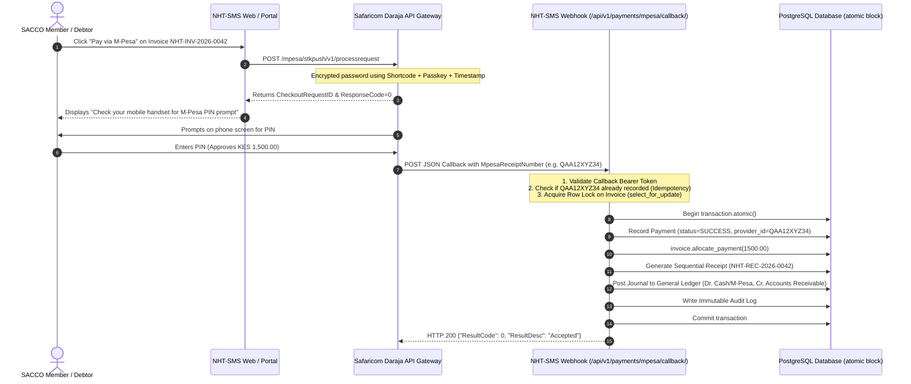

# Payment Integration Guide (Safaricom Daraja M-Pesa & Financial Controls) — NHT-SMS

**System:** Northern Highways Transporters SACCO Management System (NHT-SMS)  
**Primary Gateway:** Safaricom Daraja API 2.0 (Lipa na M-Pesa Online STK Push & C2B)  
**Secondary Gateways:** Manual Bank Deposit Slips & Direct Cheque Settlement  
**Integrity Standard:** Strict Decimal Arithmetic, Row-Level Concurrency, Complete Idempotency  

---

## 1. Safaricom Daraja Integration Architecture

NHT-SMS integrates with the Safaricom Daraja REST API through the dedicated `DarajaClient` adapter located in `nht_sacco/apps/integrations/daraja.py`.



---

## 2. Concurrency & Idempotency Controls

### 2.1 Row-Level Concurrency Locking
When Safaricom delivers asynchronous payment notifications, concurrent requests or network retries targeting the same invoice could lead to balance over-settlement. NHT-SMS eliminates race conditions by employing `select_for_update()` inside an atomic transaction:

```python
with transaction.atomic():
    invoice = Invoice.objects.select_for_update().get(id=target_invoice_id)
    # Perform strict balance check and allocation
    invoice.allocate_payment(payment_amount)
```

### 2.2 Payment Idempotency Defense
Safaricom webhooks may occasionally re-deliver transactions due to temporary gateway timeouts. The payment engine enforces strict receipt idempotency:

```python
existing_payment = Payment.objects.filter(
    provider_transaction_id=mpesa_receipt,
    status=PaymentStatus.SUCCESS
).first()

if existing_payment:
    logger.warning(f"Duplicate M-Pesa callback for receipt {mpesa_receipt}. Returning 200 to acknowledge.")
    return JsonResponse({"ResultCode": 0, "ResultDesc": "Duplicate acknowledged"}, status=200)
```

---

## 3. Configuration & Credentials Management

Environment variables governing Daraja integration (configured in `.env` / `.env.production`):

| Variable | Description | Example (Sandbox) |
|---|---|---|
| `MPESA_ENVIRONMENT` | Environment toggle (`sandbox` or `live`) | `sandbox` |
| `MPESA_CONSUMER_KEY` | Daraja developer portal application consumer key | `sandbox_key_...` |
| `MPESA_CONSUMER_SECRET`| Daraja application consumer secret | `sandbox_secret_...` |
| `MPESA_BUSINESS_SHORTCODE`| Paybill or Lipa na M-Pesa shortcode | `174379` (Default Sandbox) |
| `MPESA_PASSKEY` | Cryptographic passkey for STK push password generation | `bfb279f9aa9bdbcf158e97dd71a467cd2e0c893059b10f78e6b72ada1ed2c919` |
| `MPESA_CALLBACK_URL` | Public HTTPS webhook endpoint for callbacks | `https://nht-sms.northernhighways.co.ke/api/v1/payments/mpesa/callback/` |
| `MPESA_CALLBACK_TOKEN`| Secret bearer token required in webhook headers | `cryptographic-bearer-token-string` |

> [!CAUTION]
> Never commit real live Daraja credentials to source control. Live credentials must be injected solely into the production server's `.env.production` file.

---

## 4. Manual Payment Controls (Maker-Checker Segregation)

For offline settlements (physical bank deposit slips, direct RTGS/EFT bank transfers, or cheques), NHT-SMS enforces dual-authorization controls:

1. **Maker Submission:**
   - Registry Clerk navigates to `/payments/vouchers/create/`.
   - Records customer details, invoice number, bank reference number, deposit date, and attached digital slip image.
   - Initial status: `PENDING_VERIFICATION`. No ledger movement occurs.
2. **Checker Authorization:**
   - Independent Finance Officer navigates to `/payments/vouchers/review/`.
   - Reconciles slip against the SACCO's live bank statement.
   - If verified: clicks **Approve & Post**.
   - System atomically generates an official receipt, allocates balance to the invoice, posts the journal entry to the General Ledger, and creates an audit entry.
   - **Enforced Security Gate:** If the recording clerk attempts to approve their own voucher, the system immediately rejects the transaction with HTTP 403 `PermissionDenied`.

---

## 5. Official Receipting Engine

Upon successful payment confirmation (either automated M-Pesa or authorized manual voucher):
1. The system creates a sequential, tamper-evident receipt:
   - Format: `NHT-REC-YYYY-XXXX` (e.g. `NHT-REC-2026-0042`).
2. The receipt captures exact payment timestamps, provider receipt numbers, invoice line item allocations, and cashier/system identification.
3. Branded printable receipt layout (`/portal/receipts/<id>/`) is available on demand to the paying member with strict anti-IDOR protection.
