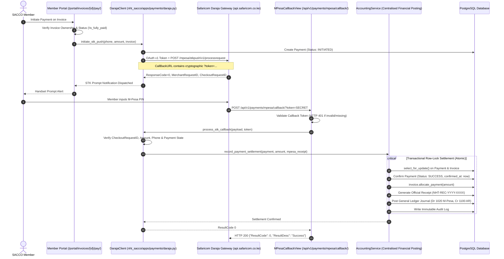

# Payment Integration Guide (Safaricom Daraja M-Pesa & Financial Controls) — NHT-SMS

**System:** Northern Highways Transporters SACCO Management System (NHT-SMS)  
**Primary Gateway:** Safaricom Daraja API 2.0 (Lipa na M-Pesa Online STK Push & C2B)  
**Secondary Gateways:** Manual Bank Deposit Slips & Direct Cash Office Vouchers  
**Integrity Standard:** Double-Entry General Ledger, Row-Level Concurrency, Token-Based Webhook Auth, Strict Idempotency  

---

## 1. Safaricom Daraja Integration Architecture

NHT-SMS integrates with the Safaricom Daraja REST API through the hardened `DarajaClient` client located in `nht_sacco/apps/payments/daraja.py`.

---

## 2. Security & Verification Controls

### 2.1 Genuine OAuth Authentication & In-Memory Token Caching
`DarajaClient` performs authentic Safaricom OAuth v1 token requests (`/oauth/v1/generate?grant_type=client_credentials`) using HTTP Basic authentication. Tokens are cached in-memory with a 60-second safety margin against expiry to prevent unnecessary authentication roundtrips.

### 2.2 Production Safety Gate
Simulated responses are strictly prohibited in production environments. When `MPESA_ENVIRONMENT` is set to `production` or `live`, `DarajaClient` communicates exclusively with live Safaricom endpoints (`https://api.safaricom.co.ke`). Startup validation halts the application if sandbox credentials or placeholders are used in production.

### 2.3 Webhook Token Authentication
Safaricom webhooks do not support arbitrary Authorization headers by default. NHT-SMS secures callback delivery via:
1. Embedding a cryptographic token query parameter in the `CallBackURL` registered during STK push: `?token=<MPESA_CALLBACK_TOKEN>`.
2. Inspecting incoming request headers (`X-Callback-Token` or `Authorization: Bearer <token>`).
3. Rejecting unauthorized requests immediately with HTTP 401 and writing a security denial entry to the immutable `AuditLog`.

### 2.4 Callback Financial Parameter Verification
Before settling any transaction, `process_stk_callback` enforces:
- **Transaction Correlation:** The `CheckoutRequestID` must match an existing payment in state `INITIATED`.
- **Amount Consistency:** The callback metadata amount must match the expected payment amount with strict `Decimal` precision.
- **Telephone Match:** The normalized callback phone number must match the initiating phone number.
- **Provider Reference Uniqueness:** The `MpesaReceiptNumber` must not already be claimed by another payment.

---

## 3. Centralised Financial Posting (`AccountingService`)

All payments—whether from Daraja STK Push callbacks, C2B PayBill notifications, or verified Manual Payment Vouchers—must execute through `AccountingService.record_payment_settlement()`.

### Key Posting Guarantees:
1. **Row-Level Locking:** Acquires `select_for_update()` locks on both the `Payment` and `Invoice` records.
2. **Double-Entry Equilibrium:** Posts balanced general ledger journal lines:
   - **Debit:** Account `1020` (M-Pesa Collections) or `1030` (Bank Collections).
   - **Credit:** Account `1100` (Accounts Receivable).
   - Enforces `entry.verify_balance()` debit-credit equality.
3. **Receipt Issuance:** Automatically generates a sequential `NHT-REC-YYYY-XXXX` receipt linked 1-to-1 with the payment.
4. **Duplicate Journal Prevention:** Verifies whether a journal entry already exists for `payment.payment_reference`. Multiple settlements of the same payment will return idempotently without duplicate journal lines.
5. **Maker-Checker Segregation:** Manual bank vouchers require independent review by financial personnel before posting.
6. **Automatic Renewal Transition:** When `record_payment_settlement()` marks an invoice `is_fully_paid`, any linked `RenewalRequest` in `INVOICED` status automatically transitions to `PAID`.
7. **Payment Reconciliation Engine (`apps/payments/reconciliation.py`):** `PaymentReconciliationService.run_reconciliation()` audits payments against receipts, invoices, and General Ledger `JournalEntry` rows, recording `ReconciliationRun` summaries and `ReconciliationException` items (`UNMATCHED_INITIATED`, `MISSING_RECEIPT`, `MISSING_JOURNAL`, `DUPLICATE_PROVIDER_REF`, `AMOUNT_MISMATCH`, `UNDERPAYMENT`, `OVERPAYMENT`) with audited resolution workflows via `/api/v1/reconciliation-runs/` and `/api/v1/reconciliation-exceptions/`.

---

## 4. Configuration & Environment Variables

| Variable | Description | Example (Sandbox) | Example (Production) |
|---|---|---|---|
| `MPESA_ENVIRONMENT` | Environment mode | `sandbox` | `live` |
| `MPESA_CONSUMER_KEY` | Daraja application consumer key | `sandbox_key_...` | `<LIVE_KEY>` |
| `MPESA_CONSUMER_SECRET`| Daraja application consumer secret | `sandbox_secret_...`| `<LIVE_SECRET>` |
| `MPESA_BUSINESS_SHORTCODE`| PayBill / Shortcode number | `174379` | `300123` |
| `MPESA_PASSKEY` | Passkey for STK push password | `bfb279f9aa9...` | `<LIVE_PASSKEY>` |
| `MPESA_CALLBACK_URL` | Public HTTPS webhook endpoint | `https://sacco.example/api/v1/payments/mpesa/callback/` | `https://nht-sms.northernhighways.co.ke/api/v1/payments/mpesa/callback/` |
| `MPESA_CALLBACK_TOKEN`| Cryptographic bearer token | `nht-mpesa-token-secret` | `<STRONG_RANDOM_SECRET_TOKEN>` |

> [!CAUTION]
> Never commit real live Daraja credentials to source control. Production configuration is validated at startup and will abort boot if default sandbox keys are present.
