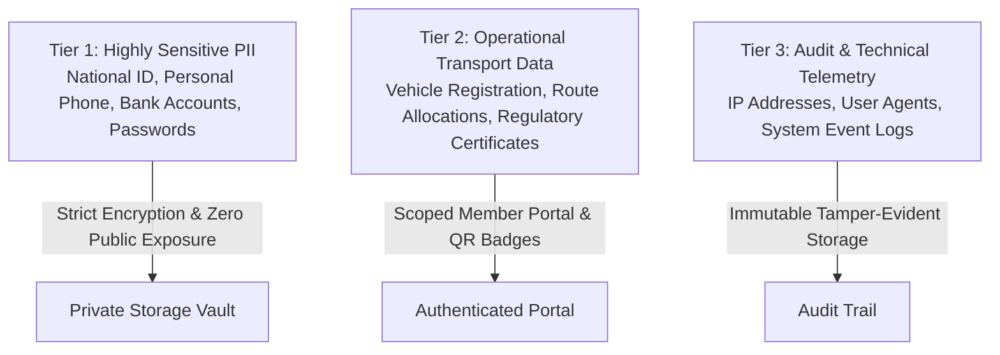

# Privacy Policy & Data Retention Framework — NHT-SMS

**System:** Northern Highways Transporters SACCO Management System (NHT-SMS)  
**Regulatory Framework:** Republic of Kenya Data Protection Act 2019 (Office of the Data Protection Commissioner — ODPC)  
**Document Version:** 1.0.0  
**Effective Date:** 2026-11-17  

---

## 1. Regulatory Context & Compliance Mandate

Northern Highways Transporters SACCO Limited processes personal and financial information of SACCO members, vehicle owners, drivers, and employees. This document defines policies, data classifications, retention periods, and security controls mandated by the **Kenya Data Protection Act, 2019 (DPA 2019)**.

The SACCO operates as a **Data Controller** for membership and financial records, and as a **Data Processor** for statutory government returns (NTSA, KeNHA, KRA).

---

## 2. Personal Data Classification

NHT-SMS categorizes collected information into three tiers of sensitivity:

### 2.1 Tier 1: Highly Sensitive Personal Data
- **Data Attributes:** Republic of Kenya National ID number, personal mobile telephone numbers, residential physical addresses, emergency next-of-kin records, M-Pesa phone numbers, and bank account/cheque numbers.
- **Handling Rules:** Access restricted strictly to authorized staff (`SACCO_ADMIN`, `REGISTRY_CLERK`) with recorded audit logs. Never exposed to public search or through QR codes.

### 2.2 Tier 2: Operational Transport & Regulatory Data
- **Data Attributes:** Vehicle registration plates, chassis numbers, engine numbers, PSV insurance policies, KeNHA road permits, NTSA road service licences, vehicle inspection certificates, and driver PSV endorsements.
- **Handling Rules:** Available to owning members and operational dispatchers. Regulatory validity status is published safely via public QR tokens without member personal attribution.

### 2.3 Tier 3: Technical & Audit Telemetry
- **Data Attributes:** Source IP addresses, browser User-Agent strings, login timestamps, and transaction audit trails.
- **Handling Rules:** Monitored by security automations (`django-axes`). Retained permanently in immutable audit tables for forensic investigation.

---

## 3. Zero-PII Public Exposure Guarantee

A core security innovation of NHT-SMS is the **Zero-PII Public QR Verification Endpoint** (`/verify/vehicle/<token>/`):
1. **Public Transit Verification:** Traffic police, NTSA roadside compliance officers, or passengers scanning a vehicle's windscreen QR code are directed to the verification endpoint.
2. **Exposed Data:** Confirms that the vehicle is actively registered with NHT-SACCO and that its mandatory certificates (Inspection, PSV Insurance, KeNHA Permit) are valid and verified.
3. **Withheld Data:** Member names, national IDs, telephone numbers, financial invoices, and private PDF certificates are **strictly omitted** from public templates and payloads.

---

## 4. Statutory Data Retention Schedules

Data retention periods balance privacy rights with statutory Kenyan tax and transportation laws:

| Data Category | Statutory Authority | Retention Period | Post-Retention Disposition |
|---|---|---|---|
| **Accounting & Invoices** | Kenya Tax Procedures Act (Cap 469B) | **7 Years** from posting date | Archival to offline cold storage; ledger lines remain immutable |
| **Membership Records** | Co-operative Societies Act (Cap 490) | **10 Years** following membership cessation | Redacted; identity anonymized |
| **Vehicle Compliance Docs** | NTSA PSV Regulations | **5 Years** from certificate expiry date | Automated deletion from private vault |
| **Security Audit Logs** | OWASP ASVS & DPA 2019 | **7 Years** | Compressed and cryptographically sealed |
| **Authentication Sessions** | ISO 27001 / ASVS V3 | **90 Days** | Automated cron pruning |

---

## 5. Data Subject Rights & Workflows

Under Part IV of the Kenya Data Protection Act 2019, SACCO members possess the following rights:

1. **Right of Access (DPA Sec. 26(a)):**
   - Members can view all personal details, registered vehicles, invoices, and payment receipts on demand via the Member Portal (`/portal/`).
2. **Right to Rectification (DPA Sec. 26(b)):**
   - Members may request corrections to phone numbers or email addresses via their portal support ticket or at the SACCO registry desk.
3. **Right to Erasure / "Right to be Forgotten" (DPA Sec. 40):**
   - Members terminating cooperative membership may request deletion of non-statutory records.
   - Financial ledger entries, published resolutions, and audited payment receipts **cannot** be deleted due to conflicting legal retention mandates under the Tax Procedures Act. Personal names on old invoices are anonymized upon formal written request.
4. **Right to Data Portability (DPA Sec. 38):**
   - Members can export their complete financial statement and fleet history in PDF or Excel formats via the portal.

---

## 6. Incident Response & Breach Notification Protocol

In the event of an unauthorized data breach involving personal identifiers:
1. **Containment (Hour 0 - 2):** Immediate network isolation of affected nodes; suspension of compromised credentials.
2. **Forensic Analysis (Hour 2 - 24):** Extraction of immutable audit logs to determine the exact scope of affected member records.
3. **Regulatory Notification (Within 72 Hours):** Formal incident notification submitted to the **Office of the Data Protection Commissioner (ODPC)** in compliance with DPA Section 43.
4. **Member Communication:** Clear written notification dispatched via SMS and WhatsApp to affected members outlining mitigation advice.
