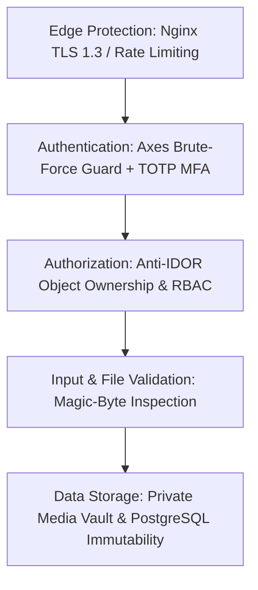

# Security Architecture & ASVS Level 2 Verification — NHT-SMS

**System:** Northern Highways Transporters SACCO Management System (NHT-SMS)  
**Security Standard:** OWASP Application Security Verification Standard (ASVS) Level 2  
**Target Environment:** Production Ubuntu VPS / Containerized Deployment  
**Audit Status:** Stage 8 Complete & Verified (13 Security Verification Tests Passing)  

---

## 1. Executive Security Architecture

NHT-SMS employs a **Defense-in-Depth** security model designed to safeguard sensitive member personal identifiable information (PII), proprietary SACCO vehicle registries, and immutable financial accounting records.



---

## 2. Authentication & Credential Hardening (ASVS V2)

1. **Password Policy:**
   - Enforces a minimum length of 10 characters with mandatory attribute similarity, common password, and numeric checks.
   - Hashed using PBKDF2 with SHA-256 and high iteration counts.
2. **Brute-Force & Credential Stuffing Defense (`django-axes` 9.0):**
   - Monitors IP addresses and username handles.
   - Locks out further authentication attempts after **5 consecutive failures** within a 1-hour cooling-off window (`AXES_FAILURE_LIMIT = 5`).
   - Failed attempts log security audit entries and render a hardened lockout template (`accounts/lockout.html`).
3. **Multi-Factor Authentication (`django-otp` 1.7):**
   - Supports standard TOTP (Time-Based One-Time Passwords) via Google Authenticator, Microsoft Authenticator, or Aegis.
   - Staff roles (`SACCO_ADMIN`, `FINANCE_OFFICER`, `SYSTEM_ADMIN`) require mandatory MFA before accessing administrative consoles.

---

## 3. Session & Transport Security (ASVS V3 & V9)

Production settings enforce strict browser security headers:

| Setting | Production Value | Purpose |
|---|---|---|
| `SECURE_SSL_REDIRECT` | `True` | Automatically upgrades unencrypted HTTP requests to TLS/HTTPS. |
| `SESSION_COOKIE_SECURE` | `True` | Ensures session cookies are transmitted exclusively over encrypted HTTPS connections. |
| `CSRF_COOKIE_SECURE` | `True` | Ensures CSRF cookies are transmitted exclusively over encrypted HTTPS connections. |
| `SESSION_COOKIE_HTTPONLY` | `True` | Prevents client-side scripts from reading session cookies via JavaScript. |
| `CSRF_COOKIE_HTTPONLY` | `True` | Restricts CSRF token access to the browser network stack. |
| `SESSION_COOKIE_SAMESITE` | `'Lax'` | Defends against Cross-Site Request Forgery (CSRF). |
| `SECURE_HSTS_SECONDS` | `31536000` (1 Year) | Forces browsers to strictly communicate over HTTPS. |
| `SECURE_HSTS_INCLUDE_SUBDOMAINS` | `True` | Extends HSTS enforcement across all subdomains. |
| `SECURE_HSTS_PRELOAD` | `True` | Qualifies domain for browser HSTS preload inclusion lists. |
| `X_FRAME_OPTIONS` | `'DENY'` | Prohibits embedding in iframes, preventing clickjacking attacks. |
| `SECURE_CONTENT_TYPE_NOSNIFF` | `True` | Prevents browser MIME-type sniffing attacks. |

---

## 4. File Upload & Binary Magic-Byte Inspection (ASVS V12)

Regulatory document uploads (logbooks, inspection certificates, PSV insurance policies, KeNHA permits) represent a high-risk attack vector. NHT-SMS enforces multi-layered upload validation (`nht_sacco/apps/documents/validators.py`):

1. **Rigid Extension Whitelisting:** Permits only `.pdf`, `.jpg`, `.jpeg`, and `.png`. Disallows `.php`, `.sh`, `.exe`, `.py`, `.js`.
2. **Binary Magic-Byte Inspection:** Inspects raw file headers to verify genuine binary signatures:
   - PDF: `%PDF-` (`\x25\x50\x44\x46`)
   - JPEG: `\xff\xd8\xff`
   - PNG: `\x89PNG\r\n\x1a\n` (`\x89\x50\x4e\x47\x0d\x0a\x1a\x0a`)
   - **Evasion Defense:** Renaming a shell script to `document.pdf` fails magic-byte verification and raises `ValidationError`.
3. **Storage Vault Isolation:**
   - Uploaded files are stored in `media/private/` outside the web document root.
   - Nginx explicitly returns HTTP 403 Forbidden for any direct request targeting `/media/private/`.
4. **Cryptographic Checksumming:**
   - A SHA-256 hash is computed immediately upon receipt and stored in `Document.file_hash` to detect post-upload tampering.

---

## 5. System-Wide Anti-IDOR Authorization (ASVS V4)

To prevent Insecure Direct Object References:
- All customer and vehicle URLs reference UUIDv4 tokens rather than sequential integer IDs.
- Views explicitly check object ownership:
  ```python
  if vehicle.current_owner != request.member and not request.user.is_staff:
      AuditLog.objects.create(
          actor=request.user,
          action='IDOR_ATTEMPT_BLOCKED',
          resource_type='Vehicle',
          resource_id=str(vehicle.id),
          outcome=AuditOutcome.DENIED
      )
      raise PermissionDenied("Access Denied: You do not own this vehicle record.")
  ```

---

## 6. Cryptographic & Accounting Immutability (ASVS V10)

1. **Tamper-Evident Audit Logs:**
   - Model-level override prevents update (`UPDATE`) and deletion (`DELETE`) on `AuditLog`:
     ```python
     def save(self, *args, **kwargs):
         if not self._state.adding:
             raise ValidationError("AuditLog entries are immutable and cannot be updated.")
         super().save(*args, **kwargs)

     def delete(self, *args, **kwargs):
         raise ValidationError("AuditLog entries cannot be deleted.")
     ```
2. **Posted General Ledger Immutability:**
   - Once a journal entry is posted (`is_posted = True`), modifying or deleting the entry or its lines raises `ValidationError`.
   - Corrections must strictly utilize balanced offsetting reversal journals (`is_reversal = True`).
