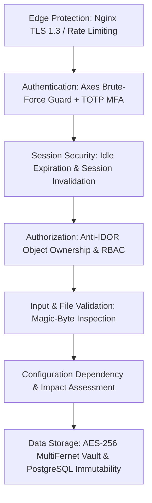

# Security Architecture & ASVS Level 2 Verification — NHT-SMS

**System:** Northern Highways Transporters SACCO Management System (NHT-SMS)  
**Security Standard:** OWASP Top 10 (2021) & OWASP Application Security Verification Standard (ASVS) v4.0 Level 2  
**Target Environment:** Production Ubuntu VPS / Containerized Docker Multi-Container Stack  
**Audit Status:** Stage 11 Complete & Verified (144 Automated Tests Passing Across 11 Stages)  
**Reports:** [SECURITY_AUDIT_REPORT.md](file:///data/data/com.termux/files/home/NHT-SMS/docs/SECURITY_AUDIT_REPORT.md) & [SECURITY_REMEDIATION_REPORT.md](file:///data/data/com.termux/files/home/NHT-SMS/docs/SECURITY_REMEDIATION_REPORT.md)  

---

## 1. Executive Security Architecture

NHT-SMS employs a **Defense-in-Depth** security model designed to safeguard sensitive member personal identifiable information (PII), proprietary SACCO vehicle registries, dynamic system settings, and immutable financial accounting records.



---

## 2. Authentication & Credential Hardening (ASVS V2)

1. **Password Policy:**
   - Enforces a minimum length of 10 characters with mandatory attribute similarity, common password, and numeric checks.
   - Hashed using PBKDF2 with SHA-256 and high iteration counts.
   - Standardized anti-user-enumeration password reset workflow (`CustomPasswordResetView`).
2. **Brute-Force & Credential Stuffing Defense (`django-axes` 9.0):**
   - Monitors IP addresses and username handles.
   - Locks out further authentication attempts after **5 consecutive failures** within a 1-hour cooling-off window (`AXES_FAILURE_LIMIT = 5`).
   - Failed attempts log security audit entries and render a hardened lockout template (`accounts/lockout.html`).
3. **Multi-Factor Authentication (RFC 6238 TOTP):**
   - Built-in TOTP device enrollment via `/accounts/mfa/setup/` (providing URI compatible with Google Authenticator, Microsoft Authenticator, and Aegis).
   - Challenge verification via `/accounts/mfa/verify/`.
   - Strict anti-replay defense: records last verified time-step to prohibit token reuse within step intervals.
4. **Forced Password Change Enforcement:**
   - Users flagged with `must_change_password=True` are restricted exclusively to password change and logout endpoints via `SessionSecurityMiddleware`.

---

## 3. Session & Transport Security (ASVS V3 & V9)

1. **Production Transport Hardening:**
   - `SECURE_SSL_REDIRECT = True` (automatic HTTP to HTTPS upgrade).
   - Strict cookies: `SESSION_COOKIE_SECURE = True`, `CSRF_COOKIE_SECURE = True`, `SESSION_COOKIE_HTTPONLY = True`, `CSRF_COOKIE_HTTPONLY = True`.
   - SameSite cookie protection: `SESSION_COOKIE_SAMESITE = 'Lax'`, `CSRF_COOKIE_SAMESITE = 'Lax'`.
   - HSTS active: `SECURE_HSTS_SECONDS = 31536000` (1 Year) with `includeSubDomains` and `preload`.
2. **Role-Based Idle Session Timeouts:**
   - Administrative and Management Staff: **30-minute idle inactivity timeout** (`SESSION_IDLE_TIMEOUT_STAFF_SECONDS = 1800`).
   - Ordinary Members: **12-hour session lifetime** (`SESSION_IDLE_TIMEOUT_MEMBER_SECONDS = 43200`).
3. **Active Session Invalidation on Credential Change:**
   - On password update or reset, `CustomPasswordChangeView` automatically purges all secondary active sessions belonging to the user from `django.contrib.sessions.models.Session`, ensuring lost or compromised devices are immediately disconnected.
4. **Suspicious Login Detection:**
   - `log_user_login` compares incoming IP against `user.last_login_ip` and emits high-priority `SECURITY_ALERT` entries to the immutable `AuditLog` on IP mismatch.

---

## 4. Cryptographic Key Management & Zero-Downtime Rotation (ASVS V2.10)

1. **Independent Production Encryption Key:**
   - Production environments strictly enforce `SETTINGS_ENCRYPTION_KEY` independence. If absent or identical to `SECRET_KEY`, `CryptoService` halts startup with `ImproperlyConfigured`.
   - Containerized deployments can securely inject secrets via `SETTINGS_ENCRYPTION_KEY_FILE` (Docker Secrets / Kubernetes volume mounts).
2. **MultiFernet Fallback Decryption:**
   - Fallback keys declared in `SETTINGS_ENCRYPTION_KEY_FALLBACKS` ensure that existing records encrypted under prior keys can be decrypted without downtime during deployment cycles.
3. **Atomic Key Rotation Management Command:**
   - Administrators can rotate the master encryption key and re-encrypt all database secrets in a single atomic database transaction:
     ```bash
     # Dry-run validation
     python manage.py rotate_encryption_key --new-key="<32_char_new_key>" --dry-run

     # Production execution
     python manage.py rotate_encryption_key --new-key="<32_char_new_key>"
     ```
   - Emits an immutable `AuditLog` entry tracking rotation metrics.
4. **Secret Masking at Rest and in Transit:**
   - Secrets stored in `SystemConfiguration` are stored encrypted with prefix `enc:`.
   - UI and API representations automatically mask plaintext: `••••••••ABCD` (preserving only trailing 4 characters for verification). Plaintext credentials never appear in API responses, logs, or audit records.

---

## 5. Configuration Dependency Awareness & Import Integrity (ASVS V1.4 & V14.2)

1. **Dependency Awareness & Critical Mutation Guarding:**
   - High-risk operational settings (`business.currency`, `mpesa.business_shortcode`, `mpesa.environment`) are governed by `ConfigurationDependencyRegistry`.
   - Updates to critical settings require explicit confirmation (`confirm_critical=True`).
   - Clients evaluate operational blast radiuses beforehand via `POST /settings/api/v1/assess-impact/`.
2. **Optimistic Concurrency Control:**
   - Updates support `expected_version`. If a concurrent administrator modified the setting in the interim, update is rejected with HTTP 400 to prevent race-condition overwrite.
3. **Cryptographic Checksum Verification on Batch Import:**
   - Configuration archives exported from NHT-SMS include a SHA-256 integrity checksum.
   - Batch import verifies the computed payload hash against `sha256_checksum`, rejecting tampered files.

---

## 6. File Upload & Binary Magic-Byte Inspection (ASVS V12)

1. **Rigid Extension Whitelisting:** Permits only `.pdf`, `.jpg`, `.jpeg`, and `.png`.
2. **Binary Magic-Byte Inspection (`validators.py`):**
   - PDF: `%PDF-` (`\x25\x50\x44\x46`)
   - JPEG: `\xff\xd8\xff`
   - PNG: `\x89PNG\r\n\x1a\n`
3. **Storage Vault Isolation:** Private documents reside in `media/private/` outside the web root, accessible only through `DocumentDownloadView` with anti-IDOR checks.

---

## 7. System-Wide Anti-IDOR Authorization (ASVS V4)

1. **UUIDv4 Non-Sequential Identifiers:** All exposed customer, vehicle, document, invoice, and payment URLs reference UUIDv4 tokens rather than predictable integer IDs.
2. **Explicit Object-Level Scoping:** Views verify object ownership or appropriate staff permissions before returning payloads, logging `IDOR_ATTEMPT_BLOCKED` to the audit ledger on violation.

---

## 8. Tamper-Proof Audit Logging & Financial Immutability (ASVS V10)

1. **Tamper-Evident Audit Ledger:** Model-level overrides on `AuditLog` prohibit `UPDATE` and `DELETE` operations at the ORM layer.
2. **General Ledger Equilibrium & Immutability:** Once a double-entry `JournalEntry` is posted (`is_posted=True`), direct edits or deletions raise `ValidationError`. Errors require balanced offset reversal entries (`is_reversal=True`).
