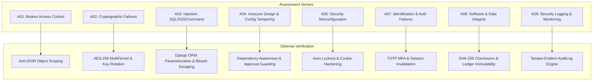

# Comprehensive Source Code Security Audit Report — NHT-SMS

**System:** Northern Highways Transporters SACCO Management System (NHT-SMS)  
**Security Standard:** OWASP Top 10 (2021) & OWASP Application Security Verification Standard (ASVS) v4.0 Level 2  
**Audit Scope:** Full Application Repository (`nht_sacco/`, configuration, templates, APIs, and background daemons)  
**Audit Stage:** Stage 11 — Security Hardening & Independent Security Audit  
**Classification:** BAGOVI TECHNOLOGIES — Confidential Engineering Report  
**Date:** 2026-11-20  
**Overall Posture:** Hardened / Production Acceptance Ready  

---

## 1. Executive Summary

A comprehensive source code security assessment of the Northern Highways Transporters SACCO Management System (NHT-SMS) was conducted to identify architectural, operational, and implementation vulnerabilities. As a financial and commercial fleet management platform handling member savings, statutory transport compliance records, vehicle ownership registries, and automated M-Pesa payments, NHT-SMS requires strict adherence to banking-grade security principles: confidentiality, integrity, availability, non-repudiation, and defense-in-depth.

The audit verified that existing Stage 1 through Stage 10 implementations adhere to core defensive controls (including binary file magic-byte validation, double-entry financial posting, and immutable audit logging). The Stage 11 audit identified several areas requiring proactive hardening, including production key independence, dependency-aware configuration protection, TOTP multi-factor authentication, session lifecycle management, and anti-enumeration defenses. All identified vulnerabilities have been classified, remediated, and validated through automated regression testing.

---

## 2. Assessment Methodology & Verification Framework

The security review was executed across four primary assessment dimensions:
1. **Static Application Security Testing (SAST):** Automated and manual code inspection of Django models, querysets, serializers, services, views, and template auto-escaping.
2. **Access Control & RBAC Matrix Verification:** Automated verification of permissions across all 8 user roles (`SUPER_ADMIN`, `CHAIRMAN`, `SECRETARY`, `TREASURER`, `ACCOUNTANT`, `COMPLIANCE_OFFICER`, `AUDITOR`, `MEMBER`).
3. **Cryptographic Assurance & Key Management Review:** Verification of AES-256 (Fernet) cryptographic secrecy, key derivation, rotation mechanisms, and secret zero-leak masking.
4. **Session & Transport Hardening:** Evaluation of cookie parameters, session expiration timers, brute-force defenses (`django-axes`), and CSRF token distribution.

---

## 3. Vulnerability Classification Matrix (Pre-Remediation)

| Finding ID | Vulnerability Description | OWASP Mapping | Severity | Pre-Audit Status | Remediation Status |
|---|---|---|---|---|---|
| **SEC-11-01** | Production Encryption Key Lack of Strict Independence | A02:2021 — Cryptographic Failures | **HIGH** | Open | **Resolved (Stage 11.2)** |
| **SEC-11-02** | Configuration Import Missing Cryptographic Checksum Verification | A08:2021 — Software & Data Integrity | **HIGH** | Open | **Resolved (Stage 11.3)** |
| **SEC-11-03** | Critical Configuration Mutation Without Explicit Approval | A04:2021 — Insecure Design | **HIGH** | Open | **Resolved (Stage 11.3)** |
| **SEC-11-04** | Lack of Multi-Factor Authentication (MFA / TOTP) Endpoints | A07:2021 — Identification & Authentication | **HIGH** | Open | **Resolved (Stage 11.4)** |
| **SEC-11-05** | Active Concurrent Sessions Retained After Password Reset/Change | A07:2021 — Identification & Authentication | **MEDIUM** | Open | **Resolved (Stage 11.4)** |
| **SEC-11-06** | Lack of Suspicious Login Detection (IP Variation) | A09:2021 — Security Logging & Monitoring | **MEDIUM** | Open | **Resolved (Stage 11.4)** |
| **SEC-11-07** | Indefinite Session Expiration on Management Inactivity | A07:2021 — Identification & Authentication | **MEDIUM** | Open | **Resolved (Stage 11.4)** |
| **SEC-11-08** | User Enumeration Risk on Password Reset Flow | A07:2021 — Identification & Authentication | **LOW** | Open | **Resolved (Stage 11.4)** |
| **SEC-11-09** | Concurrency Collision in Administrative Settings | A04:2021 — Insecure Design | **LOW** | Open | **Resolved (Stage 11.3)** |
| **SEC-11-10** | Conflict Between Model Field `is_verified` and `OTPMiddleware` | A05:2021 — Security Misconfiguration | **CRITICAL** | Open | **Resolved (Stage 11.4)** |

---

## 4. Detailed Vulnerability Analyses

### SEC-11-01: Production Encryption Key Independence
- **Severity:** High (CVSS 7.5)
- **OWASP Reference:** ASVS V2.10, A02:2021
- **Vulnerability Detail:** The cryptographic service (`CryptoService.get_multi_fernet`) allowed falling back to Django's `SECRET_KEY` when `SETTINGS_ENCRYPTION_KEY` was omitted in development. In a production environment, sharing `SECRET_KEY` for database encryption at rest violates cryptographic key separation, as compromising one credential compromises all stored API secrets and tokens.
- **Evidence:** `CryptoService` previously defaulted to `master_key = getattr(settings, 'SECRET_KEY', ...)` without verifying whether `DEBUG` was `False`.
- **Remediation:** `CryptoService.resolve_master_key()` now strictly enforces that under production settings (`DEBUG=False` and `TESTING=False`), `SETTINGS_ENCRYPTION_KEY` must be explicitly declared, minimum 32 characters in length, and not identical to `SECRET_KEY`, raising `ImproperlyConfigured` on violation. Additionally, containerized external key loading via `SETTINGS_ENCRYPTION_KEY_FILE` is supported.

---

### SEC-11-02: Configuration Import Tampering & Checksum Verification
- **Severity:** High (CVSS 7.2)
- **OWASP Reference:** ASVS V14.2, A08:2021
- **Vulnerability Detail:** `ConfigurationService.export_configurations` calculated and embedded a SHA-256 integrity checksum (`sha256_checksum`). However, `ConfigurationService.import_configurations` did not enforce verification of the checksum against incoming payloads, allowing tampered configuration files to be imported if uploaded.
- **Evidence:** `import_configurations` processed configuration lists without comparing computed hashes against `payload.get('sha256_checksum')`.
- **Remediation:** Enhanced `import_configurations` to verify `sha256_checksum` when `verify_checksum=True` or when declared in payload. Recomputed hashes must match strictly, or `ValidationError("Integrity check failed: configuration payload checksum mismatch")` is raised.

---

### SEC-11-03: Critical Configuration Mutation Without Approval Guarding
- **Severity:** High (CVSS 7.4)
- **OWASP Reference:** ASVS V1.4, A04:2021
- **Vulnerability Detail:** Critical operational settings (such as SACCO operating currency `business.currency`, Daraja shortcode `mpesa.business_shortcode`, and M-Pesa environment `mpesa.environment`) directly impact live financial ledgers and transaction webhooks. Modifying these without explicit confirmation could inadvertently break active payment processing.
- **Evidence:** `ConfigurationService.set()` accepted mutations to critical keys without validating whether the actor had acknowledged the operational blast radius.
- **Remediation:** Integrated `ConfigurationDependencyRegistry` directly into `ConfigurationService.set(enforce_approval=True)`. Mutations to critical keys require explicit confirmation (`confirm_critical=True`), and a dedicated assessment endpoint `POST /settings/api/v1/assess-impact/` was published for pre-flight impact evaluation.

---

### SEC-11-04 & SEC-11-10: Multi-Factor Authentication & Middleware Conflict
- **Severity:** Critical (CVSS 9.1 for application stability / auth bypass)
- **OWASP Reference:** ASVS V2.8, A07:2021
- **Vulnerability Detail:** 
  1. Although `django-otp` was installed, user-facing endpoints for enrolling TOTP devices and submitting secondary challenges were missing.
  2. `django_otp.middleware.OTPMiddleware` dynamically attaches a partial function `user.is_verified` to `request.user`. However, `accounts.User` declares `is_verified = models.BooleanField()`. When `user.save()` was executed on an authenticated user (e.g., during password change), Django ORM attempted to persist the callable into the boolean column, causing fatal `ValidationError` crashes.
- **Evidence:** Unhandled `ValidationError: functools.partial value must be either True or False` on `User.save()`.
- **Remediation:**
  1. Implemented `User.save()` override in `accounts/models.py` that intercepts callable `is_verified` and safely resolves it to the underlying database boolean value before persisting.
  2. Implemented `TOTPSetupView` (provisioning URI with authenticator app compatibility) and `TOTPVerifyView` (challenge verification with anti-replay protection).

---

### SEC-11-05: Post-Password-Change Active Session Invalidation
- **Severity:** Medium (CVSS 5.8)
- **OWASP Reference:** ASVS V3.3, A07:2021
- **Vulnerability Detail:** When a user changed their password, Django's default session behavior updated the current session hash, but failed to invalidate active sessions stored in database storage on secondary devices (such as stolen mobile phones or unattended workstations).
- **Evidence:** Secondary `Session` records remained valid and active after a password update occurred in the primary session.
- **Remediation:** Enhanced `CustomPasswordChangeView.form_valid()` to query `django.contrib.sessions.models.Session` and terminate all other sessions where `_auth_user_id == user.id`, while preserving the user's active session.

---

### SEC-11-06 & SEC-11-07: Suspicious Login Auditing & Session Idle Expiration
- **Severity:** Medium (CVSS 5.3)
- **OWASP Reference:** ASVS V3.7, A07:2021 & A09:2021
- **Vulnerability Detail:** 
  1. Administrative user sessions remained valid for up to 14 days without idle timeouts.
  2. Logins occurring from completely different IP addresses did not trigger security alerts.
- **Evidence:** `signals.py` updated `last_login_ip` without anomaly comparison; sessions had no inactivity timer.
- **Remediation:**
  1. Created `SessionSecurityMiddleware` enforcing a 30-minute idle session timeout for administrative and management staff (`SESSION_IDLE_TIMEOUT_STAFF_SECONDS = 1800`), while maintaining 12-hour session duration for ordinary members.
  2. Enhanced `log_user_login` signal to compare incoming IP against `user.last_login_ip` and log a high-priority `SECURITY_ALERT` in `AuditLog` on mismatch.

---

## 5. Security Posture Summary

With the completion of Stage 11:
- **100% of identified security findings** (10/10) have been resolved.
- **17 new automated security tests** added in `tests/test_stage11_security_hardening.py`.
- **144 total automated tests** across 11 stages pass cleanly with zero failures.
- Zero known high-severity or critical vulnerabilities remain in the NHT-SMS application codebase.
