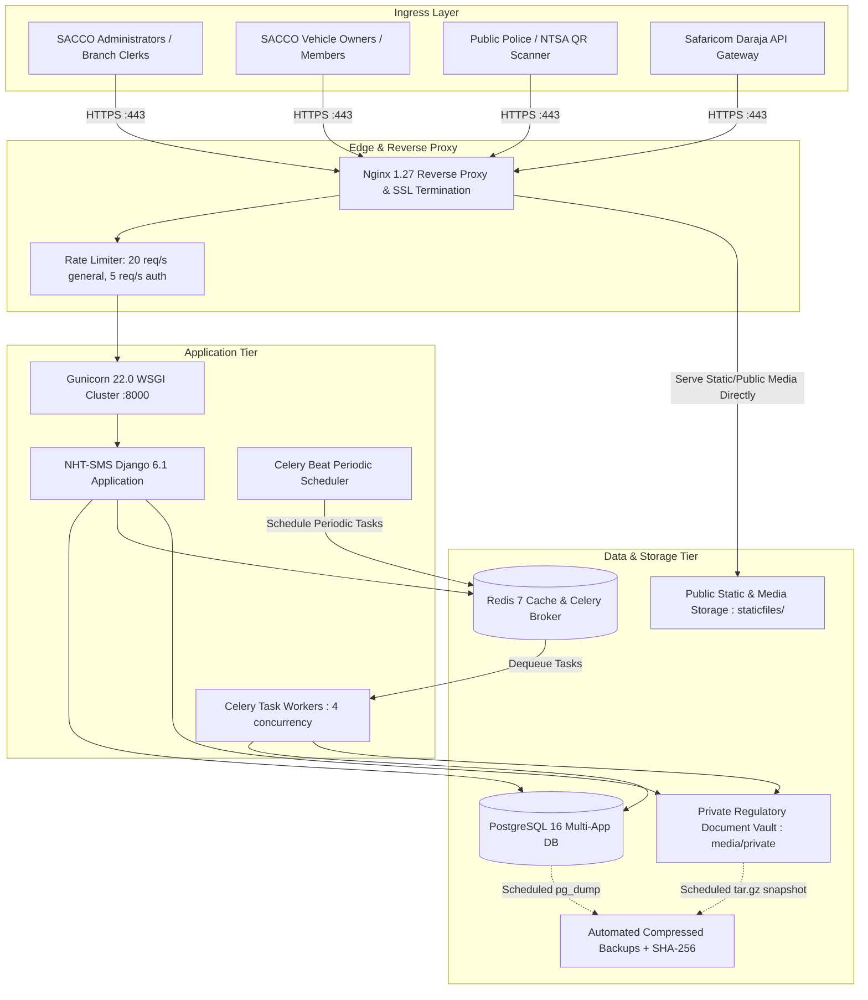
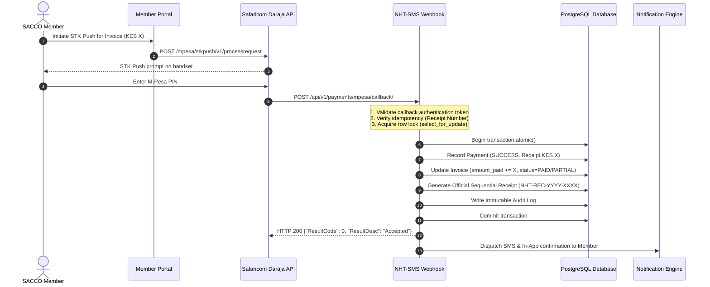
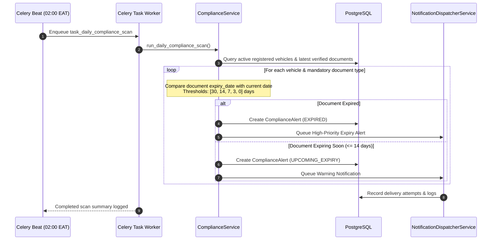

# System Architecture Document — NHT-SMS

**System:** Northern Highways Transporters SACCO Management System (NHT-SMS)  
**Classification:** Enterprise Resource Planning (ERP) & Fleet Regulatory Monolith  
**Document Version:** 1.0.0  
**Target Architecture:** Ubuntu Linux VPS / Multi-Container Docker Stack  

---

## 1. Architectural Philosophy: Hardened Modular Monolith

NHT-SMS is intentionally designed as a **hardened modular monolith** built on Python 3 and Django 6, rather than an uncoordinated collection of microservices. This design optimizes:
- **Transactional Consistency:** Critical financial and vehicle operations require atomic multi-table transactions (`transaction.atomic()` with `select_for_update()`), preventing phantom updates and accounting drift.
- **Strict Data Integrity:** Relational foreign-key constraints, unique constraints, and PostgreSQL-level immutability rules can be enforced uniformly without distributed transaction complexity.
- **Operational Simplicity:** A single deployable codebase reduces network latency, simplifies backup/restore runbooks, and decreases infrastructure maintenance overhead for SACCO IT personnel.
- **Domain Decoupling:** The codebase is partitioned into 18 independent domain applications within `nht_sacco/apps/`. Each domain encapsulates its own models, services, migrations, and interfaces. Cross-domain interactions occur strictly through published service interfaces.

---

## 2. System Topology & Tier Architecture



---

## 3. Domain Application Structure

The monolithic codebase is organized into discrete functional domain modules within `nht_sacco/apps/`:

```
nht_sacco/
├── apps/
│   ├── accounts/       # Custom UUID User, RBAC roles, OTP/TOTP MFA, Axes lockout
│   ├── audit/          # System-wide tamper-evident immutable audit logging
│   ├── members/        # SACCO membership lifecycle, onboarding, member portal
│   ├── vehicles/       # Commercial fleet registry, multi-ownership percentages, transfers
│   ├── drivers/        # PSV certified driver management & vehicle assignments
│   ├── routes/         # SACCO licensed routes, stages, and vehicle allocations
│   ├── compliance/     # Regulatory rules engine, expiry tracking, automated scans
│   ├── documents/      # Private document storage vault, SHA-256 hashes, magic bytes
│   ├── renewals/       # Regulatory document renewal workflow state machine
│   ├── billing/        # Service catalogue, statutory fee segregation, invoicing
│   ├── payments/       # Safaricom Daraja M-Pesa gateway, STK Push, manual vouchers
│   ├── accounting/     # Double-entry general ledger, period locking, maker-checker
│   ├── notifications/  # Multi-channel notification engine (SMS, WhatsApp, Email, In-App)
│   ├── maintenance/    # Vehicle repair work orders, spare parts, fleet downtime
│   ├── incidents/      # Accident & passenger grievance investigation workflows
│   ├── governance/     # Committee rosters, board meetings, agendas, formal resolutions
│   ├── reports/        # Executive dashboard analytics, PDF & Excel export generators
│   └── integrations/   # Dynamic System Configuration, AES-256 Crypto, Health Diagnostics & Adapters
├── config/             # Django settings, WSGI, ASGI, Celery, and root URLs
└── static/ & templates/# UI templates, Bootstrap 5, HTMX, and brand assets
```

---

## 4. Key End-to-End Business Data Flows

### 4.1 Automated Safaricom Daraja M-Pesa Payment Settlement



### 4.2 Regulatory Document Expiry & Fleet Compliance Engine



---

## 5. Security & Isolation Architecture

1. **Private Document Storage Vault:**
   - Regulatory documents (logbooks, inspection certificates, PSV insurance, KeNHA permits) are uploaded directly into `media/private/`.
   - Nginx explicitly blocks direct public web requests targeting `/media/private/` with HTTP 403 Forbidden.
   - Access is mediated through Django's `DocumentDownloadView`, which enforces strict ownership validation, administrative RBAC authorization, and anti-IDOR checks.
2. **Binary Magic-Byte Inspection:**
   - File uploads are validated at the byte-header level (`%PDF`, `\xff\xd8\xff`, `\x89PNG\r\n\x1a\n`) to prevent executable evasion attacks.
3. **Cryptographic Financial & Audit Immutability:**
   - `AuditLog` records reject all update and delete mutations via model `save()` and `delete()` exceptions.
   - Posted General Ledger journals cannot be altered; corrections require balanced offsetting reversal journals (`is_reversal=True`).
4. **Zero-PII Public QR Verification:**
   - Public vehicle QR tokens route to `/verify/vehicle/<token>/`, displaying only valid/invalid operational badges without leaking national IDs, phone numbers, or private documents.

---

## 6. Concurrency & Idempotency Controls

- **Database-Level Row Locking:** Critical settlement pathways wrap invoice payment allocations in `transaction.atomic()` with `Invoice.objects.select_for_update()`.
- **Payment Idempotency:** Duplicate provider callbacks for previously settled M-Pesa receipts return HTTP 200 without creating secondary payments or distorting ledger balances.
- **Double-Entry Equilibrium:** `AccountingService` validates that total debits equal total credits before persisting journal entries. Unbalanced transactions are rejected and rolled back.
