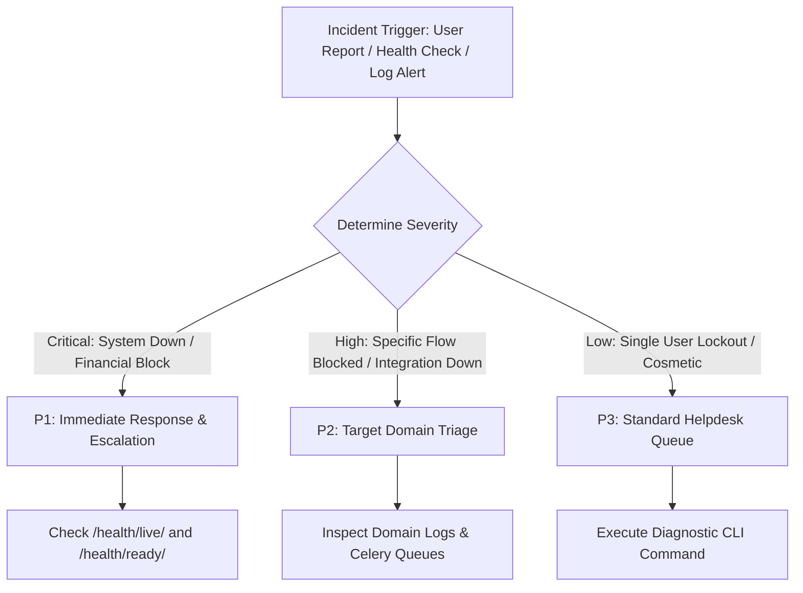

# Operations & Troubleshooting Runbook — NHT-SMS

**System:** Northern Highways Transporters SACCO Management System (NHT-SMS)  
**Audience:** SACCO Systems Administrators, DevOps Engineers, and IT Support Officers  
**Classification:** Operational Incident Triage Runbook  

---

## 1. Incident Triage Workflow



---

## 2. Common Operational Incidents & Remediation Runbooks

### 2.1 Database Connection Failure (`OperationalError: connection refused`)
- **Symptoms:** `/health/ready/` returns HTTP 503 `{"status": "degraded", "database": "error..."}`. Application web pages show HTTP 500.
- **Root Cause:** PostgreSQL daemon crashed, port 5432 blocked by firewall, or connection pool exhausted.
- **Remediation Steps:**
  1. Check PostgreSQL container or service status:
     ```bash
     # Docker:
     docker compose ps db
     docker compose logs --tail=50 db
     # Bare-metal:
     sudo systemctl status postgresql
     ```
  2. Verify database connectivity:
     ```bash
     pg_isready -h localhost -p 5432 -U nht_sms_user -d nht_sms_db
     ```
  3. If postgres service is stopped, restart:
     ```bash
     sudo systemctl restart postgresql  # Or docker compose restart db
     ```

---

### 2.2 Account Locked Out Due to Brute-Force Protection (`django-axes`)
- **Symptoms:** A legitimate staff member or SACCO director receives the lockout screen (`accounts/lockout.html`) reporting too many failed attempts.
- **Root Cause:** Operator forgot password or a third party attempted password guessing triggering `AXES_FAILURE_LIMIT = 5`.
- **Remediation Steps:**
  1. Inspect failed access attempts:
     ```bash
     python manage.py axes_list_attempts
     ```
  2. Unlock the specific IP address or username:
     ```bash
     python manage.py axes_reset_username <username>
     # Or reset by IP address:
     python manage.py axes_reset_ip <ip_address>
     ```
  3. Reset the user's password if forgotten:
     ```bash
     python manage.py changepassword <username>
     ```

---

### 2.3 Safaricom Daraja M-Pesa Callback Timeouts or Failures
- **Symptoms:** Member completed STK Push on phone, but invoice status remains `ISSUED` and no official receipt is generated.
- **Root Cause:**
  - Safaricom callback URL (`MPESA_CALLBACK_URL`) is unreachable from public internet (e.g. invalid SSL certificate or Nginx blocking request).
  - Secret bearer token mismatch in header.
- **Remediation Steps:**
  1. Inspect Nginx access and error logs for incoming callbacks:
     ```bash
     tail -f /var/log/nginx/access.log | grep "/api/v1/payments/mpesa/callback/"
     ```
  2. Check application logs for callback exceptions:
     ```bash
     docker compose logs --tail=100 web | grep -i "mpesa"
     ```
  3. If Safaricom encountered a network glitch, clerk can reconcile via manual bank/M-Pesa statement and create a `ManualPaymentVoucher` referencing the M-Pesa transaction code.

---

### 2.4 Document Upload Rejected: "Invalid file signature"
- **Symptoms:** Member or clerk receives `ValidationError: File header does not match expected binary signature` when uploading a PDF or JPEG document.
- **Root Cause:** The uploaded file is corrupted, was exported improperly by a scanner, or is a renamed file (e.g. a Word document or script renamed with `.pdf` extension).
- **Remediation Steps:**
  1. Explain to the user that NHT-SMS strictly inspects internal magic-bytes to prevent corrupted or malicious uploads.
  2. Advise the user to open the original document in a standard PDF viewer (e.g. Adobe Reader or Chrome) and select **Print to PDF** to create a clean, compliant PDF file.

---

### 2.5 Celery Background Queue Delayed or Stalled
- **Symptoms:** Compliance alerts are not sent at 02:00 EAT, or overdue invoice reminders are not delivered.
- **Root Cause:** Redis broker is stopped, or Celery worker process crashed due to Out-Of-Memory (OOM).
- **Remediation Steps:**
  1. Verify Redis is responsive:
     ```bash
     redis-cli ping  # Expects: PONG
     ```
  2. Check Celery worker and beat logs:
     ```bash
     docker compose logs --tail=100 celery_worker
     docker compose logs --tail=100 celery_beat
     ```
  3. Restart worker daemons:
     ```bash
     docker compose restart celery_worker celery_beat
     # Or on VPS:
     sudo systemctl restart nht-sms-celery-worker nht-sms-celery-beat
     ```
  4. Run on-demand CLI fallback:
     ```bash
     python manage.py run_compliance_scan
     python manage.py send_invoice_reminders
     ```

---

### 2.6 Static Assets (CSS / JS) Not Rendering in Production
- **Symptoms:** Web interface appears unstyled or missing Bootstrap icons.
- **Root Cause:** `collectstatic` was not run after pulling code, or Nginx static alias path is misconfigured.
- **Remediation Steps:**
  1. Re-collect static assets into the configured `STATIC_ROOT`:
     ```bash
     python manage.py collectstatic --noinput --clear
     ```
  2. Verify that Nginx has read permissions to the static directory:
     ```bash
     sudo chmod -R 755 /var/www/nht-sms/staticfiles/
     ```

---

## 3. Essential Diagnostic Commands Cheat Sheet

| Task | Command Line |
|---|---|
| **Verify Django Configuration** | `python manage.py check` |
| **Verify Production Deployment**| `DJANGO_SETTINGS_MODULE=nht_sacco.config.settings.production python manage.py check --deploy` |
| **Check Pending Migrations** | `python manage.py showmigrations` |
| **Clear Axes Lockouts** | `python manage.py axes_reset` |
| **Run On-Demand Compliance Scan**| `python manage.py run_compliance_scan` |
| **Dispatch Overdue Reminders** | `python manage.py send_invoice_reminders` |
| **Create Immediate DB Backup** | `./scripts/backup_db.sh` |
| **Verify Backup Checksum** | `sha256sum -c backups/db/<backup_file>.sql.gz.sha256` |
| **Execute Automated Test Suite** | `pytest` |
